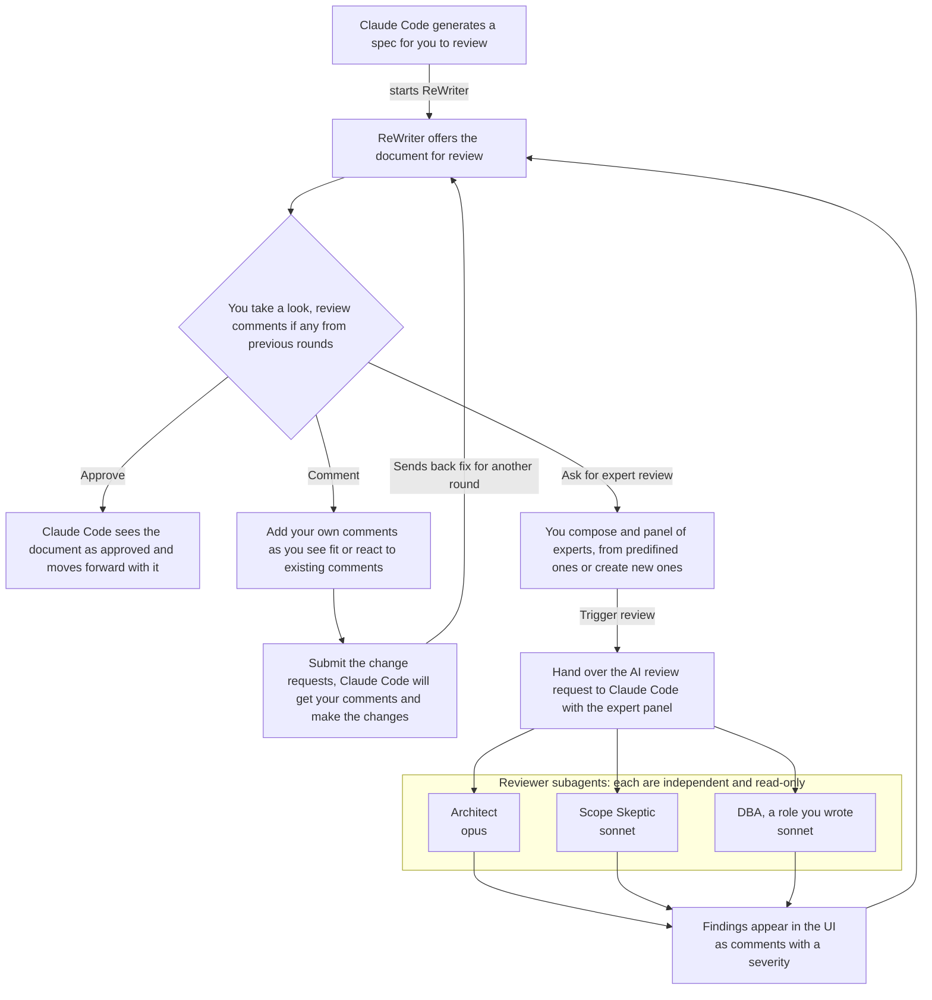

# CoMage

A Claude Code plugin. One feature so far: **ReWriter**.

## Features

### ReWriter

**Review for the documents Claude writes.**

Claude writes a spec and asks whether it looks right. Answering in chat means quoting passages back,
describing where they are, and hoping the fix landed in the right place. ReWriter gives the document the familiar review flow as a code review would:

- **Comment where the problem is.** Select any passage in the browser and leave a note. No quoting, no
  "third paragraph of section 2".
- **An answer on every comment.** Submit the round and Claude fixes the document, replies in each thread
  and hands back the new version. Round after round, until it is right.
- **A review panel on demand.** Architect, Scope Skeptic, Test Engineer, or any role you can describe. Each reviewer is a subagent of its own, on the model you pick, and they all run in parallel.
- **Reviewers that check instead of guessing.** They read your code and search the web to verify what the
  document claims. They cannot edit files or run commands.
- **You decide, not the AI.** Findings arrive as comments on the text, each with a severity from `BLOCKER`
  to `NITPICK` and often with replacement text ready to use. Approve or decline each one. Claude fixes
  only what you approved.
- **It opens itself.** Claude starts a review right after it writes a spec, plan or article draft. Press
  **Approve** when the document is good and Claude goes on with the work.
- **Your team's reviewers, in git.** Keep a reviewer library in the project and everyone gets the same
  panel. Keep another one for yourself, in every project.
- **Nothing to set up.** A local browser UI, Node 22, no `npm install`, no account. Two commands to
  [install](#install).
- **Safe in parallel.** Any number of Claude sessions, any number of documents, each review with its own
  state.
- **Mod support** Claude Code cli shows ReWriter instance tied to given session

## Contents

- [Install](#install)
- [Using ReWriter](#using-rewriter)
  - [Flow](#flow)
  - [Review rounds](#review-rounds)
  - [Several sessions at once](#several-sessions-at-once)
    - [Footer link](#footer-link)
  - [Reviewers](#reviewers)
- [Layout](#layout)
- [License](#license)
- [Development](#development)

## Install

For yourself, in every project (user level, the default):

```bash
claude plugin marketplace add Zolikon/comage
claude plugin install comage@comage
```

For one project only, run from that project's root:

```bash
claude plugin marketplace add Zolikon/comage --scope project
claude plugin install comage@comage --scope project
```

| Scope | Written to | Who gets the plugin |
|---|---|---|
| `user` (default) | `~/.claude/settings.json` | you, in every project |
| `project` | `.claude/settings.json` in the project | everyone who works in the project, once the file is committed |
| `local` | `.claude/settings.local.json` in the project | you, in this project only; the file is not committed |

Use `--scope local` in both commands for a project-only install that stays off your teammates' machines.

Or, from a local checkout, try it for one session without installing:

```bash
claude --plugin-dir path/to/comage
```

Requires Node 22. There is nothing to `npm install`.

## Using ReWriter

### Flow


### Review rounds

```
/comage:rewriter docs/specs/auth.md
```

You rarely need to type that. Claude opens ReWriter on its own after it writes a spec, plan or article
draft for you, or when you ask for a review ("review docs/specs/auth.md", "review it with a DBA and a
security reviewer").

Each round ends with one of three buttons:

- **Submit round**: Claude acts on your comments and on your decisions about reviewer comments.
- **AI review**: the reviewers you pick, each on the model you pick, read the document and post their
  findings. Nothing is fixed in that round; your own pending items wait for your next **Submit round**.
- **Approve**: the document is final as it stands. The review is closed, its server stops, its browser tab
  closes (where the browser lets a page close its own tab; otherwise the page says it can be closed), and
  Claude goes on with what the document was for. Anything still open is not acted on (the dialog tells you
  how much), and the review's state is removed. If the document has to change after all, it gets a new
  review.

While a round is with Claude, the page shows neither the document nor its comments: both are out of date
by then. In their place an animation says that work is going on, and for an AI review it shows every
reviewer of the panel by name, each with its model. The document comes back with the next round; earlier
rounds stay in the round list.

Review state is stored in `.rewriter/` at the project root: the git repository the document is in, or
the document's own folder when it is in none. The folder ignores itself in git, so there is nothing to add
to a `.gitignore`. It holds reviews in progress only: an approved review is removed, and when nothing is
under review the folder is gone. Reviews from versions before 1.4.0, which kept their state beside each
document, move to the project root the first time they are used.

### Several sessions at once

ReWriter is safe to use from any number of Claude sessions in parallel.

- Each document has its own review state, so sessions working on different documents share nothing.
- Each document has one UI server. A second session asking for it gets the running server's URL instead
  of a new one. A server stops by itself after two hours without a browser tab (`serve --idle-minutes N`,
  `0` = never), or as soon as its review is approved, and comes back on the same URL when it is started
  again.
- While Claude works on a round, that round belongs to the session that picked it up. If two sessions
  watch the same document, one gets the round and the other is told to leave it. `rewriter claim <doc>`
  hands a round to a new session when the one that held it is gone.
- Writes to a review are locked, so parallel commands never overwrite each other.
- The browser tab is named after the Claude session working on the review (`<session title> · <document>`),
  and follows the session when it is retitled or renamed.

#### Footer link

While a review UI that a session opened is running, ReWriter shows its address under that session's
prompt (`ReWriter · auth.md http://127.0.0.1:4870/`), one entry per document. It goes away when the server
stops, and a session with no review UI shows nothing. `rewriter running` prints the same list. Terminal
only for now.

### Reviewers

Reviewers are kept in two libraries, whichever way the plugin is installed:

| Library | File | Who has it |
|---|---|---|
| Yours | `~/.claude/rewriter/reviewers.json` | you, in every project |
| The project's | `.claude/rewriter/reviewers.json` at the project root | everyone working in the project, once the file is committed |

Both have the same shape and can be edited by hand:

```json
{ "library": [{ "persona": "DBA", "background": "Owns the production database. Looks at migrations and query cost.", "model": "sonnet" }] }
```

On a name clash the project's reviewer wins over yours, and yours over a built-in starter. A project that
keeps reviewers of its own also decides its default panel: they are what "run the default panel" means in
that project, and what the dialog preloads on a document's first AI review. A list under a document type
(`"spec": [...]`, `"plan": [...]`) is for documents of that type only; `library` is for all of them.

The **AI review** dialog has the panel (who runs, each with its model), the library and an editor:

- Tick a reviewer to put it in the panel. The library is grouped (this project's, yours, the starters) and
  has a filter.
- Select a reviewer to read or edit it. **+ New reviewer** starts an empty one, **Duplicate** one from the
  reviewer shown.
- Edits to a reviewer in the panel count at once, for this document only. **Save to** *This project* or
  *My library* keeps them.
- **Import** and **Export** beside each library merge in or download a `reviewers.json`, to share
  reviewers with someone who doesn't work in the project. Import replaces reviewers of the same name and
  leaves the rest.

The panel has no upper limit, but every reviewer is a separate subagent run; 2–5 usually cover a document.
Reviewers run as the plugin's own `comage:reviewer` agent: it can read files and search the web to check
what the document says, and it cannot edit files or run commands.
The **?** in the dialog explains how a review runs.

The starters are in `reviewers.default.json`, grouped by document type. That grouping only matters when you
ask Claude in chat for "the default panel".

## Layout

| Path | What |
|---|---|
| `.claude-plugin/` | plugin and marketplace manifests |
| `skills/rewriter/` | the skill (`SKILL.md`) and the reviewer prompt template |
| `agents/reviewer.md` | the subagent every reviewer runs as: review rules, output format, read-only tools |
| `bin/rewriter` | CLI launcher, on Claude's `PATH` while the plugin is enabled |
| `rewriter.mjs`, `lib/` | CLI, review model, local server, reviewer registry |
| `ui/` | browser UI |
| `vendor/` | bundled `marked` (MIT), so no install step |
| `test/` | `npm test` |

## License

MIT. Bundled `marked` keeps its own license in `vendor/marked.LICENSE`.

## Development

```bash
npm test
claude plugin validate .
```
